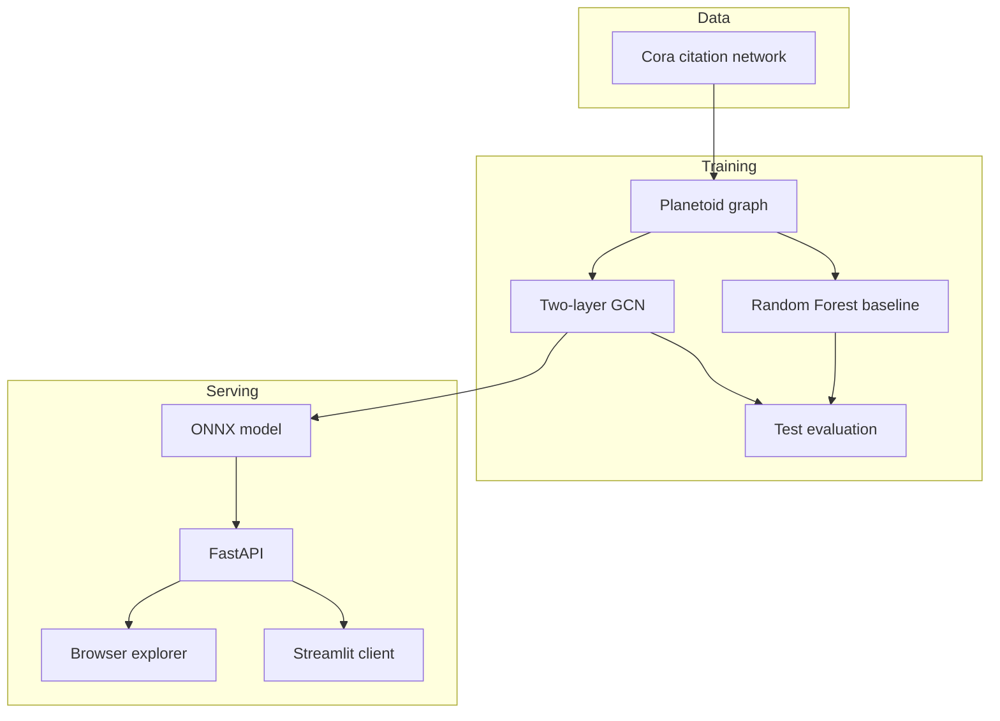
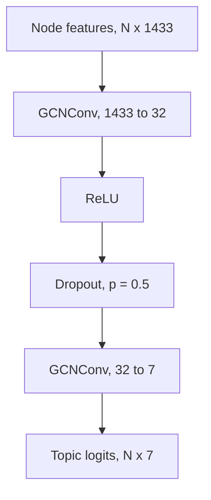

# Research Paper Classification with Graph Convolutional Networks

Classify scientific papers into one of seven research topics by combining what a paper says with which papers it cites.

Each paper is a node. Each citation is an edge. A two-layer Graph Convolutional Network (GCN), built in PyTorch Geometric, learns a topic for every paper from a 1,433-word bag-of-words vector and the citation neighborhood around it. On the public Cora test set of 1,000 papers, the GCN reaches **79.2% accuracy** and **0.782 macro-F1**. A Random Forest that sees the same word features, and none of the citation neighborhood, reaches **58.1% accuracy** and **0.570 macro-F1**.

The trained network is exported to ONNX and served with FastAPI, with a browser explorer and a Streamlit client for live node classification.

## What this project covers

- A citation graph in which papers are nodes and citations are edges, so topic prediction can use relational structure as well as text features.
- Graph preprocessing, full-batch training, validation-based early stopping, and held-out evaluation for semi-supervised node classification.
- A two-layer GCN (`GCNConv`) that aggregates each paper with its citation neighbors.
- A conventional baseline on the same split, used to measure what the graph adds.
- Export of the trained model to ONNX and an inference API that classifies real Cora papers or a caller-supplied graph.

## Architecture



## Dataset

The project uses the **Cora** citation network through PyTorch Geometric’s `Planetoid` loader. Cora is a standard benchmark for semi-supervised node classification.


|                                |                                              |
| ------------------------------ | -------------------------------------------- |
| Papers (nodes)                 | 2,708                                        |
| Citation edges in `edge_index` | 10,556                                       |
| Features per paper             | 1,433 binary word indicators                 |
| Topics                         | 7                                            |
| Labeled training papers        | 140 (20 per topic)                           |
| Validation papers              | 500                                          |
| Test papers                    | 1,000                                        |
| Remaining papers               | 1,068, unlabeled, used only as graph context |


Planetoid stores each citation in both directions, so `edge_index` has shape `[2, 10556]`. Node features are binary: a coordinate is 1 when that vocabulary word appears in the paper. Labels are research topics:


| ID  | Topic                  | Papers |
| --- | ---------------------- | ------ |
| 0   | Case Based             | 298    |
| 1   | Genetic Algorithms     | 418    |
| 2   | Neural Networks        | 818    |
| 3   | Probabilistic Methods  | 426    |
| 4   | Reinforcement Learning | 217    |
| 5   | Rule Learning          | 180    |
| 6   | Theory                 | 351    |


Topics are uneven, so macro-F1 is reported next to accuracy. The split is the public Planetoid split used by Kipf & Welling: the model may use the full graph, and the loss is computed only on the 140 training labels.

## Method


### Representation

A paper enters the model as a 1,433-dimensional binary vector `x`, together with the citation list `edge_index`. The task is node classification: predict `y` for every paper. The notebook also draws a 100-node sample of the citation graph, colored by topic, to show that connected papers often share a subject. That pattern is the reason a neighborhood model can help when labeled papers are scarce.

### Baseline: TF-IDF features and a Random Forest

The baseline asks how far word features alone can go.

Binary word indicators are reweighted with scikit-learn’s `TfidfTransformer`, so words that appear in many papers count for less. A `RandomForestClassifier` (100 trees, `max_features="sqrt"`, `class_weight="balanced"`, `random_state=42`) is fit on the 140 training papers and scored on the 1,000 test papers. It never aggregates neighbor features. Each paper is classified from its own vector.

### Model: two-layer GCN

`GCNConv` implements the Kipf & Welling graph convolution. One layer replaces a paper’s vector with a normalized mix of itself and the papers it is linked to, then applies a learned linear map.

$$
H^{(l+1)} = \sigma\left(\tilde{D}^{-\frac{1}{2}} \tilde{A} \tilde{D}^{-\frac{1}{2}} H^{(l)} W^{(l)}\right)
$$

$\tilde{A}$ is the citation graph with self-loops, $\tilde{D}$ is its degree matrix, $H$ holds the current paper vectors, and $W$ is trained.

`SimpleGCN` stacks two of those layers:



The first layer builds a 32-dimensional paper embedding from the word vector and the immediate citation neighborhood. The second layer reads that embedding, looks at the neighborhood again, and produces one logit per topic. Two layers means a paper is influenced by its citations and by the papers those citations cite.

### Training

Training is full-batch and transductive. Every step runs the GCN on all 2,708 papers and all citations. Cross-entropy is applied only where `train_mask` is true.


| Setting        | Value                                                                             |
| -------------- | --------------------------------------------------------------------------------- |
| Optimizer      | Adam, learning rate `0.01`                                                        |
| Loss           | Cross-entropy on the 140 training labels                                          |
| Dropout        | 0.5, active only in training                                                      |
| Epoch budget   | 200                                                                               |
| Early stopping | Patience of 20 epochs on validation accuracy                                      |
| Checkpoint     | Weights with the best validation accuracy are restored before the test evaluation |


In the saved notebook run, training stopped at **epoch 35**. The restored checkpoint had a validation accuracy of **0.812**. Training accuracy reached 1.0, which is expected with only 140 labels; the validation and test numbers are the ones that measure generalization.

The notebook records one training run. A later run can move these figures slightly with a different weight initialization or package version.

### Export and serving

After evaluation, the notebook exports the restored network to `simple_gcn_cora.onnx` (ONNX opset 18) with dynamic axes for the number of nodes and edges. Inputs are `node_features` (`float32`, `[num_nodes, 1433]`) and `edge_indices` (`int64`, `[2, num_edges]`). The output is `logits` (`float32`, `[num_nodes, 7]`).

`main.py` loads that file with ONNX Runtime and exposes it over FastAPI. Softmax and the topic names are applied in the API, outside the graph. Two clients sit on top of the same service:

- `static/` is a browser explorer served by FastAPI. It classifies Cora papers by node index, accepts a custom graph, and reads model metadata from `/info`.
- `streamlit_app.py` is a second client. It calls the same endpoints and can point at a local server or at `https://cora-project.onrender.com`.


## Results

Same Planetoid test mask (1,000 papers). Figures are from the executed notebook.


| Model                                 | Test accuracy | Test macro-F1 |
| ------------------------------------- | ------------- | ------------- |
| Random Forest on TF-IDF word features | 0.581         | 0.570         |
| Two-layer GCN                         | **0.792**     | **0.782**     |


The GCN is 21.1 percentage points higher in accuracy and 0.212 higher in macro-F1. Both models see the same 140 labels. The difference is neighborhood aggregation: the GCN lets a paper’s representation depend on the papers it cites, and the Random Forest does not.

That gain is evidence that citation structure carries topic signal on this benchmark. It is a comparison on one dataset and one run, under the standard transductive protocol. It does not by itself show that citations cause a topic label.

The notebook also saves confusion matrices for both models.

## Repository layout

```text
.
├── cora_citation_network_classification_(1).ipynb   # data, baseline, GCN, evaluation, ONNX export
├── main.py                                          # FastAPI service over the ONNX model
├── streamlit_app.py                                 # Streamlit client for the API
├── requirements.txt                                 # API dependencies
├── static/
│   ├── index.html                                   # browser explorer
│   ├── index.css
│   └── app.js
├── simple_gcn_cora.onnx                             # produced by the notebook; required to serve
└── data/Planetoid/                                  # Cora files downloaded on first load
```

`simple_gcn_cora.onnx` is created by the last section of the notebook and is not stored in git. The API reads it from the project root at startup.

## Getting started

Use Python 3.10 or newer. Install PyTorch first, then PyTorch Geometric, using the version pair listed in the [PyTorch Geometric install guide](https://pytorch-geometric.readthedocs.io/en/stable/install/installation.html).

### 1. Train, evaluate, and export

Open the notebook and run it top to bottom. The first code cell installs the training libraries (`torch`, `torch-geometric`, `scikit-learn`, `pandas`, `matplotlib`, `seaborn`, `networkx`). The Cora files download into `data/Planetoid` on first load. The final section writes `simple_gcn_cora.onnx` next to the notebook.

### 2. Serve the model

From the project root, with `simple_gcn_cora.onnx` already exported:

```powershell
pip install -r requirements.txt
uvicorn main:app --reload
```

Then open:

- Explorer: [http://127.0.0.1:8000](http://127.0.0.1:8000)
- Interactive API docs: [http://127.0.0.1:8000/docs](http://127.0.0.1:8000/docs)
- Health: [http://127.0.0.1:8000/health](http://127.0.0.1:8000/health)

The process loads the ONNX model at import time. If `simple_gcn_cora.onnx` is missing, the server will not start.

### 3. Optional Streamlit client

```powershell
pip install streamlit requests pandas
streamlit run streamlit_app.py
```

The sidebar takes an API base URL. Point it at `http://127.0.0.1:8000` for a local server. The default is the hosted service at `https://cora-project.onrender.com`.

## API


| Method | Path                 | Purpose                                              |
| ------ | -------------------- | ---------------------------------------------------- |
| `GET`  | `/`                  | Browser explorer                                     |
| `GET`  | `/health`            | Process status and the ONNX Runtime provider         |
| `GET`  | `/info`              | Feature size, class map, and ONNX input/output specs |
| `POST` | `/predict/cora_node` | Classify existing Cora papers by node index          |
| `POST` | `/predict`           | Classify a caller-supplied graph                     |


`POST /predict/cora_node` loads the Planetoid Cora graph, runs the GCN on the full graph, and returns the requested nodes. Indexes run from 0 through 2707.

```json
{ "node_indices": [0, 42, 100] }
```

`POST /predict` expects one 1,433-dimensional feature vector per node and an optional edge list of shape `[2, num_edges]`. If edges are omitted, the service places a self-loop on every node, so there is no message passing between papers.

```json
{
  "node_features": [[0.0, 1.0, 0.0]],
  "edge_indices": [[0], [0]]
}
```

Each prediction includes the node index, the predicted topic id and name, class probabilities, and the raw logits. Topic order matches the table above.

## Evaluation notes

- **Transductive protocol.** At training and at test time the GCN sees every paper’s features and every citation. Labels from the validation and test papers are not in the loss. This matches the published Cora setup. The exported model is meant for graphs of the same kind, not as a classifier that was trained only on a disjoint set of papers and then applied to a brand-new graph.
- **Small labeled set.** Twenty labels per topic is the point of the benchmark. Message passing is useful here because most papers never contribute a label, only a feature vector and a place in the citation graph.
- **Baseline preprocessing.** IDF weights are fit on the full feature matrix before the mask is applied. The Random Forest is still trained only on the 140 labeled papers and scored on the same 1,000 test papers as the GCN.
- **Single run.** The notebook does not average several seeds. The recorded test scores are 0.792 accuracy and 0.782 macro-F1 for the GCN, and 0.581 accuracy and 0.570 macro-F1 for the Random Forest.
- **What a stronger follow-up would add.** Repeating training across seeds, running the same comparison on CiteSeer and PubMed, and scoring a model that uses graph structure with no word features would separate dataset effects from the contribution of message passing.


## Stack

**Training and evaluation.** Python, PyTorch, PyTorch Geometric, NumPy, pandas, scikit-learn, Matplotlib, Seaborn, NetworkX.

**Serving.** ONNX, ONNX Runtime, FastAPI, Pydantic, Uvicorn, plus a static HTML/CSS/JS explorer and a Streamlit client.

## References

1. Kipf, T. N., & Welling, M. (2017). *Semi-Supervised Classification with Graph Convolutional Networks*. International Conference on Learning Representations. [https://arxiv.org/abs/1609.02907](https://arxiv.org/abs/1609.02907)
2. Yang, Z., Cohen, W. W., & Salakhutdinov, R. (2016). *Revisiting Semi-Supervised Learning with Graph Embeddings*. International Conference on Machine Learning. Introduces the Planetoid split used here. [https://arxiv.org/abs/1603.08861](https://arxiv.org/abs/1603.08861)
3. Sen, P., Namata, G., Bilgic, M., Getoor, L., Galligher, B., & Eliassi-Rad, T. (2008). *Collective Classification in Network Data*. AI Magazine, 29(3), 93–106. Source description of the Cora citation network.
4. Fey, M., & Lenssen, J. E. (2019). *Fast Graph Representation Learning with PyTorch Geometric*. ICLR Workshop on Representation Learning on Graphs and Manifolds. [https://arxiv.org/abs/1903.02428](https://arxiv.org/abs/1903.02428)

